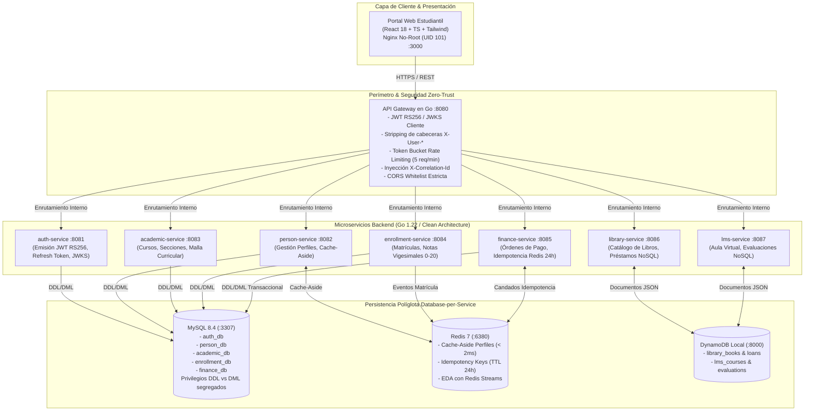
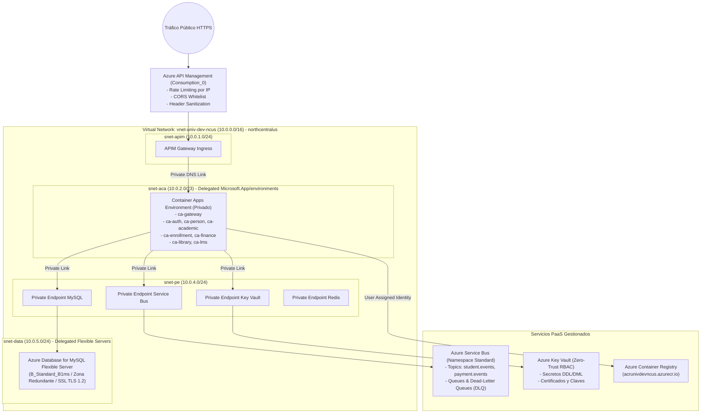
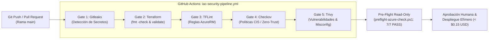

# Plataforma Cloud-Native Empresarial

[](https://github.com/carlostapiaorellana/arquitectura-cloud-iac-microservicios-azure/actions/workflows/iac-security-pipeline.yml)
[](https://www.terraform.io/)
[](https://go.dev/)
[](https://react.dev/)
[](https://azure.microsoft.com/)
[](#4-matriz-de-seguridad-zero-trust-y-resiliencia)
[](LICENSE)

> **Arquitectura de Microservicios en Go, Event-Driven con Azure Service Bus, Frontend React 18 Nginx No-Root e Infraestructura como Código (IaC) en Microsoft Azure.**

---

## 1. Resumen Ejecutivo

Esta solución implementa una **Plataforma Cloud-Native Empresarial** integral diseñada bajo los estándares de ingeniería más rigurosos de la industria:
- **Clean Architecture de 6 capas** y contratos **12-Factor App** en Go 1.22 distribuidos en monorepo `go.work`.
- **Perímetro Zero-Trust**: API Gateway con firma asimétrica **JWT RS256** validada contra **JWKS** en memoria, sanitización mandatoria de cabeceras entrantes (*Header Stripping* de `X-User-*`), **Rate Limiting Token Bucket** por IP y **CORS estricto** sin comodines.
- **Frontend SPA de Alto Rendimiento**: React 18, TypeScript strict, TanStack Query v5, Tailwind CSS y Zustand con tokens volátiles en memoria RAM para neutralizar ataques XSS, empaquetado en contenedor **Nginx unprivileged no-root** (`UID 101`).
- **Persistencia Políglota Database-per-Service**: Segregación estricta de 5 esquemas relacionales en MySQL 8.4 con usuarios desacoplados DDL (`*_migrator`) y DML (`*_user`), caché distribuida y candados de idempotencia transaccional (TTL 24h) en Redis 7, y persistencia documental NoSQL.
- **Infraestructura como Código (IaC)**: 39 módulos atómicos de Terraform para Microsoft Azure (`northcentralus`) orquestando VNet segmentada, Container Apps privados, Azure Service Bus con Dead-Letter Queues (DLQ), MySQL Flexible Server con Private Endpoints, Azure Key Vault, Azure API Management (`Consumption_0`) y Federación OIDC para GitHub Actions.
- **DevSecOps & FinOps**: Pipeline CI/CD automatizado con 5 gates de seguridad (**Gitleaks, Terraform Fmt/Validate, TFLint, Checkov, Trivy**), suite de resiliencia ante caos y marco de validación efímera con costo residual garantizado de **`$0.00 USD / mes`**.

---

## 2. Diagramas de Arquitectura del Sistema

### Arquitectura de Aplicación C4 (Flujo Transaccional)



### Topología de Infraestructura Cloud en Microsoft Azure



### Cadena DevSecOps CI/CD (5 Gates Automatizados)



---

## 3. Catálogo de Microservicios y Topología de Red

| Servicio | Contenedor | Puerto Host / Red | Rol y Responsabilidad Arquitectónica |
|---|---|---|---|
| **API Gateway** | `univ-api-gateway` | `http://localhost:8080` | Reverse proxy en Go. Autenticación asimétrica JWT RS256, JWKS, rate limiting Token Bucket (5 req/min), CORS estricto y sanitización Zero-Trust. |
| **Portal Web** | `univ-web-portal` | `http://localhost:3000` | SPA React 18 + TS strict empaquetada en `nginxinc/nginx-unprivileged:1.27-alpine` (UID 101). Tokens volátiles en RAM, caché inmutable de 1 año. |
| **Auth Service** | `univ-auth-service` | Red interna `:8081` | Emisión y verificación de tokens JWT asimétricos RS256, rotación de refresh tokens, JWKS público y hashing bcrypt. |
| **Person Service** | `univ-person-service` | Red interna `:8082` | Gestión de identidades institucionales y perfiles. Patrón Cache-Aside sobre Redis 7 con invalidación en mutaciones. |
| **Academic Service** | `univ-academic-service` | Red interna `:8083` | Facultades, programas académicos, cursos, secciones y programación horaria. |
| **Enrollment Service**| `univ-enrollment-service` | Red interna `:8084` | Matrículas, inscripciones y calificaciones con escala vigesimal peruana (0–20). |
| **Finance Service** | `univ-finance-service` | Red interna `:8085` | Órdenes de pago, conceptos, pasarela y procesamiento transaccional con candados de idempotencia estricta en Redis. |
| **Library Service** | `univ-library-service` | Red interna `:8086` | Catálogo documental NoSQL de libros, control de inventario y préstamos estudiantiles. |
| **LMS Service** | `univ-lms-service` | Red interna `:8087` | Aula virtual NoSQL, cursos inscritos, avance porcentual y evaluaciones académicas. |
| **MySQL Relacional** | `univ-local-mysql` | `127.0.0.1:3307:3306` | MySQL 8.4 multi-base lógica (`auth_db`, `person_db`, `academic_db`, `enrollment_db`, `finance_db`). Privilegios segregados DDL vs DML. |
| **Redis Distribuido**| `univ-local-redis` | `127.0.0.1:6380:6379` | Redis 7 Alpine. Cache-Aside (< 2ms), bus local de eventos (Redis Streams) y candados de idempotencia transaccional (TTL 24h). |
| **DynamoDB Local** | `univ-dynamodb-local` | `127.0.0.1:8000:8000` | Emulador NoSQL en memoria para dominios documentales (`library_books`, `lms_courses`). |

---

## 4. Matriz de Seguridad Zero-Trust y Resiliencia

1. **Header Stripping Mandatorio**: El API Gateway elimina activamente cualquier cabecera `X-User-*` (`X-User-Id`, `X-User-Role`, `X-User-Scopes`) enviada desde el cliente externo antes de transferir la petición al backend, evitando suplantación de identidad.
2. **Tokens en Memoria RAM Volátil**: El `accessToken` reside únicamente en el closure de estado de Zustand en la memoria RAM del navegador, neutralizando el robo por script injection (XSS) en `localStorage`. La sincronización multi-pestaña de logout se gobierna mediante `BroadcastChannel`.
3. **Idempotencia Transaccional Concurrente**: Las peticiones de pago (`POST /api/v1/finance/payments`) incorporan cabecera `Idempotency-Key`. Ante ráfagas masivas concurrentes, Redis garantiza exactamente 1 inserción en MySQL y reenvía el recibo original en $< 1\text{ ms}$.
4. **Degradación Grácil Fail-Open**: Ante una caída abrupta de Redis, los microservicios degradan automáticamente a consultas directas a MySQL sin interrumpir el servicio ni devolver errores 500 al cliente.
5. **Aislamiento de Radio de Explosión (Blast Radius 0%)**: La indisponibilidad de un servicio satélite es contenida por el Gateway, devolviendo un sobre JSON estandarizado `503 Service Unavailable` sin degradar el resto de la plataforma.

---

## 5. Guía de Inicio Rápido (Quickstart Local)

### Prerrequisitos
- **Docker Desktop** con soporte de Docker Compose v2.
- **PowerShell 5.1+** (o PowerShell Core 7+).
- **Go 1.22+** (para compilación local opcional) y **Node.js 20+**.

### 1. Clonar el Repositorio
```bash
git clone https://github.com/carlostapiaorellana/arquitectura-cloud-iac-microservicios-azure.git
cd arquitectura-cloud-iac-microservicios-azure
```

### 2. Iniciar la Plataforma Local (12 Contenedores)
Ejecuta el script de orquestación local:
```powershell
powershell -ExecutionPolicy Bypass -File "scripts/local-up.ps1"
```
El script levantará automáticamente MySQL, Redis y DynamoDB, inyectará los bootstraps DDL/DML, compilará los microservicios en Go y levantará el Portal Web Estudiantil en Nginx.

### 3. Acceder al Portal Web y Credenciales Demo
- **URL del Portal Web**: [http://localhost:3000](http://localhost:3000)
- **API Gateway**: [http://localhost:8080](http://localhost:8080)
- **Credenciales Demo**:
  - **Usuario**: `alu01`
  - **Contraseña**: `password123`

### 4. Ejecutar Suites de Pruebas Automatizadas
```powershell
# Suite de Smoke Tests (16 Comprobaciones Funcionales)
powershell -ExecutionPolicy Bypass -File "scripts/test-smoke.ps1"

# Suite E2E de Resiliencia, Concurrencia y Caos (11 Comprobaciones PASS)
powershell -ExecutionPolicy Bypass -File "scripts/test-e2e-resilience.ps1"
```

### 5. Detener el Entorno Local
```powershell
powershell -ExecutionPolicy Bypass -File "scripts/local-down.ps1"
```

---

## 6. Despliegue en Microsoft Azure (Infraestructura como Código)

La carpeta `infra/terraform/` contiene los **39 módulos atómicos** y la orquestación del entorno `dev`.

### Pre-Vuelo y Validación Estática (Solo Lectura)
```powershell
powershell -ExecutionPolicy Bypass -File "scripts/preflight-azure-check.ps1"
```
El script valida sintaxis, formato canónico, coherencia de los 39 módulos y la conexión en modo `--read-only` hacia la suscripción de Azure (`northcentralus`).

### Despliegue Efímero Supervisado
Para desplegar temporalmente en la nube y destruir de inmediato (costo < $0.15 USD por sesión), consulta el runbook paso a paso:
- [Runbook Operativo de Despliegue Efímero](docs/architecture/runbook-despliegue-efimero.md)

---

## 7. Licencia y Autor

Desarrollado y mantenido por **Carlos Tapia Orellana** (Cloud Solutions Architect & Lead Developer).  
Distribuido bajo la licencia [MIT](LICENSE).
