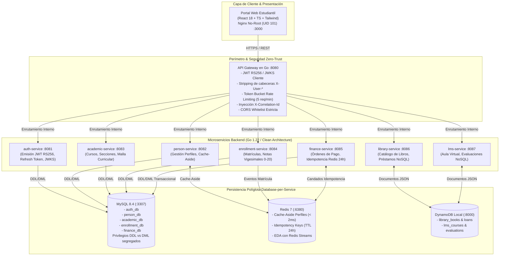
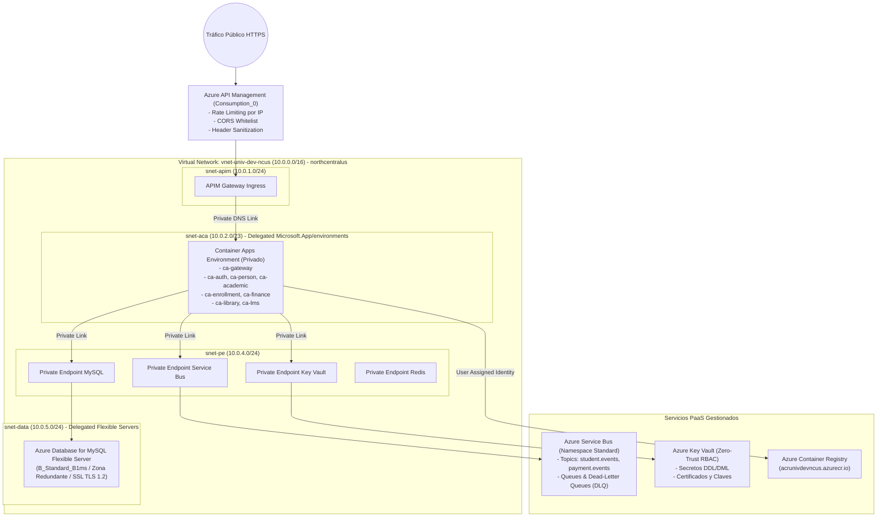
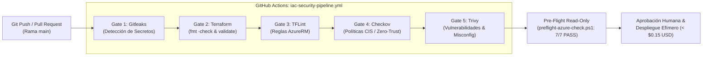

# Especificación de Diagramas de Arquitectura (Mermaid)

Este documento contiene las especificaciones formales de arquitectura para la **Plataforma Cloud-Native Empresarial**: arquitectura de aplicación C4, topología de infraestructura en Microsoft Azure y la cadena de suministro de seguridad DevSecOps CI/CD.

---

## 1. Arquitectura de Aplicación (C4 / Flujo de Solicitudes)

---

## 2. Topología de Infraestructura Cloud en Microsoft Azure

---

## 3. Cadena DevSecOps CI/CD y Gates de Seguridad

