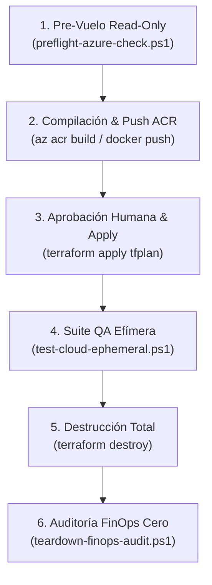

# Runbook Operativo: Despliegue Efímero, Validación Cloud y Destrucción ($0.00 USD)

> [!IMPORTANT]
> **Directiva Constitucional `NO_DEPLOY` (`AGENTS.md §3.1`)**: Queda estrictamente prohibido que cualquier subagente ejecute comandos mutantes (`terraform apply`, `terraform destroy`, `az ... create|delete|update`) sin aprobación humana explícita previa sobre un plan formalmente revisado.

---

## 1. Contexto y Filosofía de Operación Efímera

- **Entorno**: Microsoft Azure (`Azure for Students`, Subscripción `94846a8b-9491-4312-82bb-3082c340b45f`).
- **Región Designada**: `northcentralus`.
- **Topología Enterprise Tier-1**: APIM (`Consumption_0`), Azure Container Apps (7 microservicios + 1 Gateway), Azure Service Bus (Namespace Standard con Tópicos/Colas), Azure Database for MySQL Flexible Server (`B_Standard_B1ms`), Azure Key Vault y Private Link / Private DNS.
- **Ventana Operativa**: **30 a 45 minutos** por sesión de prueba.
- **Presupuesto Consumido Estimado**: **< $0.15 USD** por sesión.
- **Balance Residual Obligatorio**: **$0.00 USD / mes** (destrucción total certificada).

---

## 2. Flujo Operativo Paso a Paso (6 Fases)



---

### Paso 1: Pre-Vuelo y Validación Estática (Solo Lectura)

Antes de considerar cualquier interacción con Azure, certificar que el 100% de los 38 módulos y el entorno dev sean válidos:

```powershell
powershell -ExecutionPolicy Bypass -File "scripts/preflight-azure-check.ps1"
```
- **Criterio de Aceptación**: `7/7 checks PASS` (Terraform v1.14+, 38 módulos, validación dev, sesión Azure `northcentralus` confirmada).

---

### Paso 2: Compilación y Publicación de Imágenes en ACR

Tras la creación de ACR o en la etapa de preparación de contenedores, iniciar sesión y compilar las imágenes:

```powershell
# Iniciar sesión en el registro privado
az acr login --name acrunivdevncus

# Lista de microservicios a compilar y publicar:
$services = @("gateway", "auth", "person", "academic", "enrollment", "finance", "library", "lms", "web")
foreach ($svc in $services) {
    Write-Host "Publicando imagen univ-$svc:latest en ACR..." -ForegroundColor Cyan
    # docker build -t acrunivdevncus.azurecr.io/univ-$svc:latest ...
    # docker push acrunivdevncus.azurecr.io/univ-$svc:latest
}
```

---

### Paso 3: Despliegue de Infraestructura Supervisado

> [!CAUTION]
> **Punto de Control Humano**: Solicitar autorización explícita al operador antes de ejecutar `terraform apply`.

```powershell
cd "infra/terraform/environments/dev"

# 1. Inicializar con backend local o remoto seguro
terraform init -backend=false

# 2. Generar y revisar el plan de ejecución
$env:TF_VAR_mysql_admin_password = "TuPasswordSeguro123!Prod"
terraform plan -out=tfplan

# 3. Aplicar exclusivamente el plan generado
terraform apply tfplan
```

---

### Paso 4: Suite de Pruebas de Humo Cloud (QA Efímero)

Una vez que el despliegue complete con éxito, obtener el FQDN de APIM y el API Gateway y ejecutar la suite de certificación:

```powershell
# Obtener endpoint público de APIM o Container App Gateway
$apimUrl = terraform output -raw apim_gateway_url

# Ejecutar la suite QA perimetral
powershell -ExecutionPolicy Bypass -File "../../../scripts/test-cloud-ephemeral.ps1" -ApimEndpoint $apimUrl
```
- **Validaciones**:
  - `GET /health/live`: HTTP 200 OK.
  - `POST /api/v1/auth/login`: Emisión de JWT RS256.
  - Purga de `X-User-*` (Zero-Trust Header Stripping).
  - Preflight CORS estricto para `http://localhost:3000` (HTTP 204) y rechazo 403 a dominios no autorizados.

---

### Paso 5: Destrucción Inmediata Supervisada

Finalizadas las pruebas (o transcurridos 45 minutos), proceder de inmediato a la destrucción para cumplir la directiva FinOps:

```powershell
cd "infra/terraform/environments/dev"
terraform destroy
```

---

### Paso 6: Auditoría FinOps de Salida y Certificación Cero ($0.00 USD)

Verificar de forma independiente que ningún recurso facturable haya quedado huérfano:

```powershell
powershell -ExecutionPolicy Bypass -File "scripts/teardown-finops-audit.ps1"
```
- **Criterio de Aceptación**: `4/4 checks PASS`. Confirmación de 0 recursos activos en `rg-univ-dev-ncus` y certificación formal de balance residual `$0.00 USD`.
